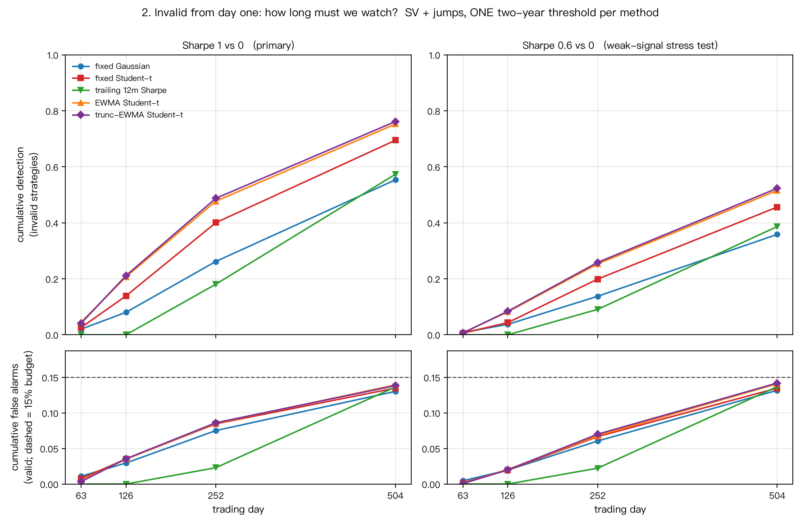

# strategy-survivorship

A newly deployed trading strategy is either valid or invalid. **Under an acceptable
cumulative false-alarm budget, how quickly can the invalid one be identified?**
This repository answers the question by simulation and expresses the answer in trading
days, years, detection rates and failure probabilities. A second, smaller part compares
the simulation generator with real index returns (S&P 500 and others) as a diagnostic.

**What it does not claim.** It is a simulation study, not a validation of a live
deployment. Every lead of one method over another holds under the stated data-generating
processes and the rules as implemented, not in general. The real-data stages are
diagnostics of one model; they do not identify the "true" parameters of any market.

The main results and their limitations are in [docs/RESULTS.md](docs/RESULTS.md).

## Main result

Main scenario: stochastic volatility with jumps, Sharpe 1 (valid) against 0 (invalid),
two-year cumulative false-alarm budget 15%, truncated-EWMA Student-t statistic.
Cumulative share of invalid strategies detected after each observation length:

| observation length | one quarter | half a year | one year | two years |
|---|---|---|---|---|
| **Sharpe 1 (main line)** | 4.1% | 21.1% | 48.7% | **76.2%** |
| Sharpe 0.6 (weak-signal stress test) | 0.6% | 8.4% | 25.8% | **52.3%** |



## Layout

```
src/strategy_survivorship/
  config.py            every simulation parameter, the random-stream namespace, the data directory
  noise.py simulate.py return generators (five noise laws) and seeded path simulation
  detectors.py ewma.py monitoring statistics (binary log-odds, trailing Sharpe, EWMA variants)
  evaluate.py          calibration, first passage, detection / false-alarm metrics, intervals
  probability_time.py gaussian_bound.py   analytic references
  plots.py figures_brief.py               shared figure style and the four main figures
  stage1.py ... stage3b.py, mixed_noise.py  one module per simulation stage (run, report, figures)
  market_data.py market_returns.py market_diagnostics.py   real-data loading and return rules
  market_stage1.py ... market_stage4.py, market_cross.py, market_assets.py,
  market_recovery.py, market_sensitivity.py   one module per real-data stage
tests/          regression and property tests (analytic moments, first passage, truncation,
                random failure-time boundaries, causality, protocol checks)
docs/           RESULTS.md (main results), DATA.md (external data specification), figures/
theory.md       notation, units and derivations
CLAUDE.md       project conventions (statistical wording, code and figure rules)
```

Each stage module is run as `python -m strategy_survivorship.<stage>`. Generated files
(CSV, JSON, Markdown reports, figures) are written under `outputs/` relative to the working
directory, so run every command from the repository root. `outputs/` and `data/` are not
under version control.

## Install

Python 3.13.13 with the pinned versions in `requirements-lock.txt` reproduces the recorded
runs exactly. With [uv](https://docs.astral.sh/uv/):

```bash
uv venv --python 3.13.13 .venv
uv pip install --python .venv/bin/python -r requirements-lock.txt
uv pip install --python .venv/bin/python --no-deps -e .
```

Without uv, any Python 3.13 works the same way:

```bash
python3.13 -m venv .venv
.venv/bin/pip install -r requirements-lock.txt
.venv/bin/pip install --no-deps -e .
```

Runtime dependencies are numpy, scipy, pandas and matplotlib; pytest is needed for the tests.

## Quick synthetic example (no data, no network, a few seconds)

```bash
.venv/bin/python -m strategy_survivorship.stage1 --smoke --out outputs/smoke
```

This simulates valid and invalid strategies with small sample sizes, calibrates the
thresholds, evaluates every detector and writes `outputs/smoke/stage1_metrics.csv`,
`stage1_report.md` and figures. `--smoke` numbers are a pipeline check, not research results.

## Tests

```bash
.venv/bin/python -m pytest
```

481 tests, about 30 s. Tests that check numbers in generated artefacts skip with a
reason when those artefacts have not been generated locally.

## Reproducing the simulation study

The simulation stages need no external data. Run them in this order (about 10 minutes in
total on a laptop according to the recorded runs):

```bash
for s in stage1 stage11 stage2a stage2b stage2c stage2d stage2e stage2e1 \
         stage3a stage3a1 stage3b mixed_noise; do
  .venv/bin/python -m strategy_survivorship.$s
done
.venv/bin/python -m strategy_survivorship.figures_brief    # the four main figures in docs/figures
```

Dependencies between stages: `stage2d` and `stage2e` read the Stage 2C unified thresholds
(`outputs/stage2c_unified_thresholds.csv`); `stage2e1` reads the Stage 2E thresholds and
metrics; `stage3b` reads the Stage 3A thresholds; `stage11` optionally reads Stage 1 first
passages. A missing upstream file stops the command with `missing input: <path>` and the
command to run first.

Every stage accepts `--out DIR` (default `outputs/`) and `--smoke` (small samples, for
checking the pipeline). Figures and reports can be redrawn from saved CSVs without any
simulation:

```bash
make figures      # figures_brief plus --figures-only for 2D, 2E, 3A, 3A.1, 3B
make reports      # --report-only for 3A.1 and 3B, and the mixed-noise report
```

**Seeds.** All randomness comes from one root seed (`config.Stage1Config.root_seed =
20260905`) split into named child streams (`config.STREAM_ORDER`, append-only). A few
stages use additional fixed seeds written in their modules. With the pinned environment the
outputs are bit-for-bit reproducible.

## Real-data stages

These need third-party market data that the repository does not contain. The required
files, fields, units, calendars and the exact snapshots used (with SHA-256) are listed in
[docs/DATA.md](docs/DATA.md). Put the snapshots in `data/raw/` or point the environment
variable `STRATEGY_SURVIVORSHIP_DATA_DIR` at the directory that holds them:

```bash
export STRATEGY_SURVIVORSHIP_DATA_DIR=/path/to/raw-snapshots
.venv/bin/python -m strategy_survivorship.market_stage1 --reuse-snapshot   # S&P 500 reference (seconds)
.venv/bin/python -m strategy_survivorship.market_stage2 --paths 2000       # frozen-generator contrast
.venv/bin/python -m strategy_survivorship.market_stage3                    # calibrate A and rho, validate
.venv/bin/python -m strategy_survivorship.market_stage4                    # walk-forward replay (about 2 min)
.venv/bin/python -m strategy_survivorship.market_cross --paths 2000        # cross-market baseline
.venv/bin/python -m strategy_survivorship.market_assets --paths 1500       # cross-asset baseline
.venv/bin/python -m strategy_survivorship.market_recovery                  # parameter recovery (about 9 min)
.venv/bin/python -m strategy_survivorship.market_sensitivity               # seed sensitivity (about 4 min)
.venv/bin/python -m strategy_survivorship.market_returns                   # return-boundary agreement check
```

`market_stage1` must run first: stages 2-4 read its per-day series from `outputs/market/`.
Always pass `--reuse-snapshot`: without it the command downloads a fresh FRED vintage into
the data directory and later results may change. Reports and figures of the real-data
stages are regenerated from saved outputs with `python -m strategy_survivorship.<stage>
report` (stages 1-4, cross, recovery, sensitivity) and `... <stage> plots` (assets,
recovery, sensitivity). When an input is missing the command stops with
`missing input: <path>`; no command ever falls back to synthetic data.

## Cost of each command

| command | what it does | cost |
|---|---|---|
| `stage*`, `mixed_noise` | full simulation | about 10 min for all of them |
| `... --smoke` | same pipeline, small samples | seconds |
| `... --figures-only`, `--report-only`, `figures_brief`, `<market stage> report/plots` | read saved CSV/JSON only | seconds |
| `market_stage1 --reuse-snapshot`, `market_returns` | read raw snapshots | seconds |
| `market_stage2`, `market_stage3`, `market_cross`, `market_assets` | simulation against real data | minutes (not re-timed here) |
| `market_stage4`, `market_sensitivity`, `market_recovery` | repeated calibrations | about 2, 4 and 9 min |

## Entry points renamed in the 2026-09 consolidation

| before | now |
|---|---|
| `python -m strategy_survivorship.run_<stage>` | `python -m strategy_survivorship.<stage>` |
| `python -m strategy_survivorship.report_market_<x>` | `python -m strategy_survivorship.market_<x> report` |
| `python -m strategy_survivorship.plots_market_<x>` | `python -m strategy_survivorship.market_<x> plots` |
| `python -m strategy_survivorship.run_market_returns_check` | `python -m strategy_survivorship.market_returns` |
| `python -c "...report_mixed_noise..."` | `python -m strategy_survivorship.mixed_noise report` |

All flags are unchanged. The consolidation was checked against the previous version with
smoke runs of every stage, small runs of every real-data stage and read-only regeneration
of every report and figure: all CSV values are identical and every computed number in the
reports is unchanged. Reports and figure labels are now in English.

## Limitations

Simulation study; candidate Sharpe ratios are {1, 0.6} and the detectors know the candidate
values; the five noise scenarios come from one family; Stage 3B covers failures within the
first year only; calibration covers the listed fixed scenarios only; all intervals are
per-item intervals; the evaluation counts detections and false alarms only and does not
price the cost of waiting.
