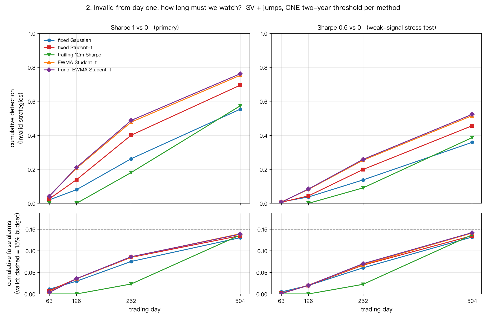
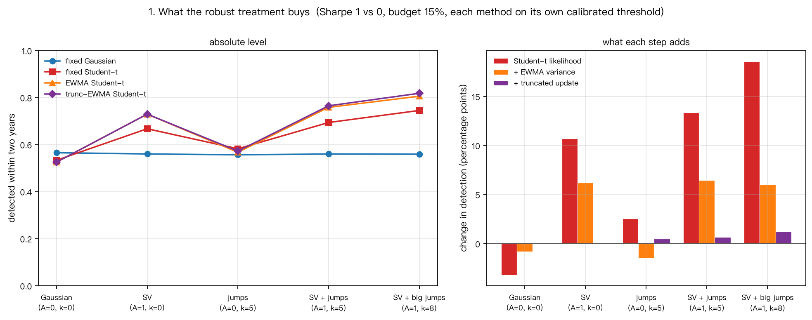
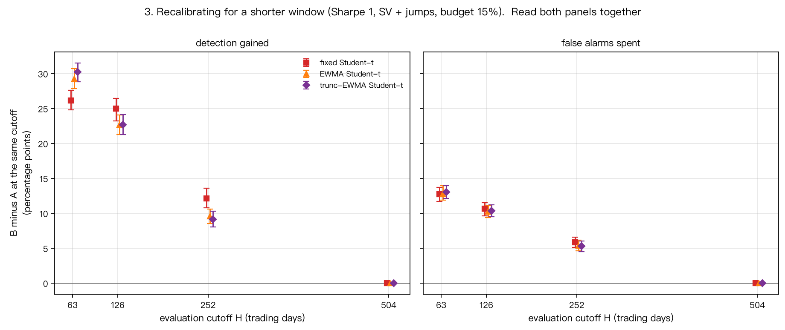
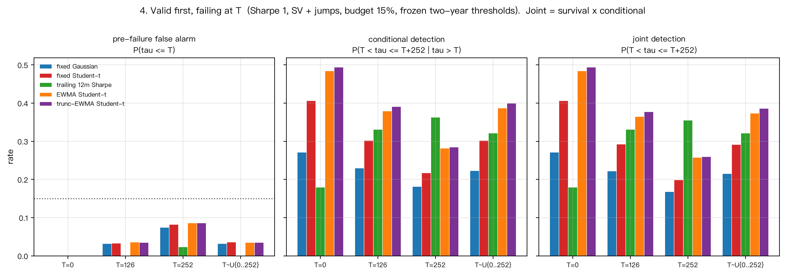

# Results and conclusions

This page summarises what the project found and how far each finding reaches. Every
simulation number below comes from a results CSV written by the stage runners; the
file, the row filter and the column are given next to each table. The CSVs and
stage reports are written to `outputs/` (simulation) and `outputs/market/` (real-data
diagnostics). They are generated artefacts and are not tracked in the repository;
see the [README](../README.md) for how to regenerate them. Derivations are in
[`theory.md`](../theory.md).

**At a glance.** In the main scenario (stochastic volatility plus jumps, two-year
cumulative false-alarm budget 15%), the best implemented rule reaches the following
cumulative detection of invalid strategies after one quarter, half a year, one year
and two years.

- Sharpe 1: 4.1%, 21.1%, 48.7%, 76.2%
- Sharpe 0.6: 0.6%, 8.4%, 25.8%, 52.3%

These are simulation results under the stated data-generating process (DGP), not a
validation on live strategies.

---

## 1. The question

A new strategy is launched. It is either valid (it has a positive Sharpe ratio) or
invalid (Sharpe 0), and nobody knows which. A monitor watches its daily returns and
raises an alarm when it judges the strategy invalid. An alarm on a valid strategy is a
**false alarm**, and the monitor must keep the probability of *any* false alarm over
the whole monitoring horizon below a **cumulative false-alarm budget**. Within that
budget, how quickly can an invalid strategy be detected?

The project answers this with a **simulation study**. The answer is expressed in
trading days, years, detection rates and failure probabilities. It is **not** a
validation of a live deployment, and it makes no claim that any rule is optimal in
general.

## 2. Main setting

- **Returns.** `r_t = mu_S + sigma_0 * eps_t`, annualised volatility 10%, D = 252 trading
  days per year, monitoring horizon H = 504 days (two years), initial prior 0.5.
  Valid: `mu_1 = s * sigma_ann / D`; invalid: `mu_0 = 0`. The primary benchmark is
  **Sharpe 1 vs 0**; Sharpe 0.6 vs 0 is a later **weak-signal stress test**. The
  detector knows the two candidate means but not which one generated a path.
- **Budgets.** Nominal two-year cumulative false-alarm budgets of **5%** and **15%**;
  15% is the headline.
- **Calibration.** Each rule has one threshold, set on an independent **calibration
  set** of valid paths (10,000 per scenario) as a buffered order statistic of the
  path-wise minimum statistic, with a Bonferroni split of a 5% calibration-failure
  probability across all rules in the stage. Thresholds are **frozen** before the
  **test set** (10,000 valid and 10,000 invalid paths, independent streams) is read.
  Because of the buffer, the **realised false-alarm rate** sits below the **nominal**
  budget (about 13.4% to 14.2% at a 15% nominal budget in the tables below).
- **Five noise scenarios**, all from one family: Gaussian control (A=0, kappa=0);
  **stochastic volatility (SV)** control (A=1, kappa=0; log-variance AR(1), rho=0.98);
  **jumps** control (A=0, kappa=5; compound Poisson, lambda=2 per year); **SV + jumps**
  (A=1, kappa=5), the **main scenario**; and SV + larger jumps (A=1, kappa=8).
- **Rules compared** (eight in total): fixed-scale ("binary") Gaussian and Student-t
  (nu=5) likelihood-ratio monitors; EWMA Gaussian and EWMA Student-t, which use a
  causal EWMA variance forecast (lambda=0.94; **variance adaptation**); truncated EWMA
  Gaussian and truncated EWMA Student-t, which cap each squared residual at 16 times
  the current variance before it enters the EWMA (**truncated variance update**,
  c=4); and two rolling **baselines**, a 252-day trailing Sharpe and a rolling rule
  with known scale. An alarm is the **first passage** of the statistic below its
  threshold.

## 3. How long must we watch?

Truncated EWMA Student-t, main scenario SV + jumps, nominal budget 15%, one two-year
threshold per rule:

| Signal | One quarter (day 63) | Half a year (day 126) | One year (day 252) | Two years (day 504) | Median detection time | Truncated mean detection time |
|---|---|---|---|---|---|---|
| Sharpe 1 (primary) | 4.1% | 21.1% | 48.7% | 76.2% | 260 days | 287.7 days |
| Sharpe 0.6 (weak-signal stress test) | 0.6% | 8.4% | 25.8% | 52.3% | 475 days | 378.2 days |

Source: `outputs/stage3a_metrics.csv`, rows `scenario=sv_jump`,
`method=ewma_trunc_student_t`, `far_target=0.15`, `sharpe_valid` 1.0 and 0.6;
columns `detect_d63`, `detect_d126`, `detect_d252`, `detect_d504`,
`median_detect_days`, `trunc_mean_detect_days`. The realised false-alarm rates
(`far_total`) are 13.84% and 14.20%.

- **Even on the primary Sharpe 1 benchmark, one year of observation catches about
  half of the invalid strategies and two years about three quarters.** At Sharpe 0.6,
  two years catch about half.
- The quarter, half-year and one-year cells are read off the **same** two-year
  threshold; the budget is spent once over two years, not once per horizon.
- The **truncated mean detection time** is `E[min(tau, H)]`: paths never detected are
  counted at day 504. It is not the average time to find every invalid strategy.
  Where cumulative detection stays below 50% (several weaker rules at Sharpe 0.6),
  the median detection time is reported as **not reached within the observation
  window**, and nothing is extrapolated beyond two years.
- A conditional reference exists only for the iid Gaussian model with known variance
  and known candidate means: no rule that respects the cumulative budget can exceed
  `Phi(s*sqrt(h) - z_{1-alpha})` at horizon h years, which is 64.7% (Sharpe 1) and 42.6% (Sharpe 0.6) at two years and
  alpha = 15%. It does **not** apply to SV + jumps, so the 76.2% above is not a
  contradiction, and no ceiling has been derived for the combined scenario.
- Stage 3A draws fresh random streams, so its two-year figure for this rule
  (76.17%) differs slightly from the Stage 2E figure (76.51%) in the next section.
  Each is correct for its own run.

## 4. What the robustness treatment buys

Two-year detection at the 15% budget in the SV + jump scenario, each rule on its own
per-scenario threshold. The ladder reads:
binary Gaussian 56.03%, binary Student-t 69.41%, EWMA Student-t 75.86%,
truncated EWMA Student-t 76.51%.

| Step | Rule | Two-year detection | Increment over previous row | Realised false-alarm rate |
|---|---|---|---|---|
| baseline | binary Gaussian (fixed scale) | 56.03% | n/a | 13.42% |
| + heavy-tailed likelihood | binary Student-t (fixed scale) | 69.41% | +13.38 pp | 13.66% |
| + variance adaptation | EWMA Student-t | 75.86% | +6.45 pp | 13.53% |
| + truncated variance update | truncated EWMA Student-t | 76.51% | +0.65 pp | 13.40% |

Source: `outputs/stage2e_metrics.csv`, rows `scenario=sv_jump`, `arm=per_scenario`,
`far_target=0.15`; columns `detect_d504` and `far_d504`.

- The three steps differ by an order of magnitude: the **heavy-tailed likelihood**
  does most of the work, variance adaptation is second, and the truncated update is a
  small but measurable addition (+0.65 pp, per-item 95% interval [+0.14, +1.19] pp).
- **The cost has to be stated with the gain.** In the pure Gaussian scenario the
  robust treatment is a net loss, -3.2 pp as stated in the README. In the same CSV
  (`scenario=gaussian_ctrl`) that figure is the heavy-tailed-likelihood step (binary
  Gaussian 56.57% to binary Student-t 53.37%); the two later steps take the chain
  down to 52.57%. With no heavy tails and no volatility clustering there is nothing
  for the treatment to exploit. The advantage depends on the noise structure.
- Changing the variance update changes the rule, so thresholds must be recalibrated.
  Borrowing an earlier stage's **unified threshold** without recalibration (the
  `legacy_threshold` arm in the same CSV) gives EWMA Gaussian a realised false-alarm
  rate of 20.12% against a 15% nominal budget in SV + jumps.

## 5. The monitoring horizon

Arrangement A calibrates one two-year threshold and reads it at an earlier cutoff.
Arrangement B calibrates a separate threshold for the shorter window. EWMA Student-t,
cutoff H = 126 days, SV + jumps, nominal budget 15%, Sharpe 1:

| Arrangement | Threshold calibrated over | Detection by day 126 | Cumulative false alarms by day 126 |
|---|---|---|---|
| A: two-year threshold read at half a year | 504 days | 20.21% | 3.28% |
| B: threshold calibrated for half a year | 126 days | 42.91% | 13.50% |
| B minus A (paired, per-item 95% interval) | n/a | +22.70 pp [+21.27, +24.05] | +10.22 pp [+9.40, +11.06] |

Source: `outputs/stage3a1_metrics.csv`, rows `scenario=sv_jump`, `sharpe_valid=1.0`,
`method=ewma_student_t`, `far_target=0.15`, `cutoff_H=126`, `arm` A and B; columns
`detect` and `far`. Differences: `outputs/stage3a1_bootstrap.csv`, `kind`
`detect_B_minus_A` and `far_B_minus_A`, columns `point`, `lo`, `hi`.

In words: arm A 20.21% detection with 3.28% false alarms; arm B 42.91% with 13.50%
false alarms. The two numbers must be read together. Both arrangements see exactly
the same returns, statistics and likelihood increments on every day; B simply spends
the false-alarm budget that A keeps for the following year and a half. **No new
information is extracted.** A short-horizon threshold also inherits no two-year
guarantee: carried on to day 504, the EWMA Student-t 63-day threshold reaches a
cumulative false-alarm rate of 40.3% and its 126-day threshold 28.9%, against a 15%
budget for their own windows
(`outputs/stage3a1_out_of_horizon.csv`, column `far_extended_to_d504`). The
pre-specified primary comparison of this stage was at Sharpe 0.6, where B minus A is
+22.31 pp in detection and +11.78 pp in false alarms; the Sharpe 1 figures above are
shown because Sharpe 1 is the primary benchmark.

## 6. Valid first, failing later

The strategy is valid up to day T (the last valid day) and invalid afterwards. T is
independent of the noise. Coverage is **failure within the first year** (T <= 252),
each setting with a full 252-day post-failure window. Thresholds are the frozen
two-year thresholds from Stage 3A, not recalibrated to the true T, which is unknown
in practice. Three rates must be read together, and joint detection = survival rate
x conditional detection, where the survivors are the paths with no alarm by day T:

| Failure setting | Rule | Pre-failure false alarm | Conditional detection within 252 days | Joint detection within 252 days |
|---|---|---|---|---|
| T = 0 (invalid from launch) | EWMA Student-t | 0.00% | 48.49% | 48.49% |
| T = 252 | EWMA Student-t | 8.69% | 28.23% | 25.78% |
| T = 252 | trailing 12-month Sharpe | 2.36% | 36.36% | 35.50% |
| T uniform on 0..252 | EWMA Student-t | 3.58% | 38.74% | 37.35% |

Source: `outputs/stage3b_metrics.csv`, rows `scenario=sv_jump`, `sharpe_valid=1.0`,
`far_target=0.15`, `setting` in `fixed_T0`, `fixed_T252`, `random_uniform`, `method`
in `ewma_student_t`, `trailing_sharpe_252`; columns `pre_failure_far`,
`cond_detect_h252`, `joint_detect_h252`. The identity joint = survival x conditional
holds on every row to within 6e-17.

- **The advantage of EWMA Student-t over fixed-scale Student-t holds in every failure
  setting**: +6.48 to +8.51 pp in conditional detection, every per-item interval
  excluding zero.
- **The ranking against the rolling baseline depends on when the strategy fails.**
  EWMA Student-t minus trailing Sharpe in joint detection is +30.52 pp at T = 0,
  -9.72 pp [-10.79, -8.64] at T = 252 and +5.18 pp for uniform T. The reversal has
  **not** been decomposed. At least four candidate mechanisms could act together:
  the rolling rule's start-up period, the rolling window gradually dropping
  pre-failure data, the variance state, and selection of survivors. None is claimed
  as the cause.
- The stage's pre-specified comparison was Sharpe 0.6, T = 252; the Sharpe 1 rows are
  a change of emphasis, not a retroactive pre-specification. Intervals here describe
  test uncertainty given the frozen thresholds, not recalibration of the whole
  procedure.

## 7. Real-market work: diagnostics under the stated model

Everything in this section compares the stated generators against a small number of
historical samples. **No monitor was run on market data**, nothing here validates a
monitor on real strategies, and every simulated range is conditional on the model
and its parameters. The market outputs need the providers' source files, which are
not distributed with this repository.

**S&P 500 reference (market stage 1).** Daily price returns (dividends excluded) with
a fixed split: training 2017-2021, validation 2022-2023, holdout 2024-2025, the last
two unopened in this stage. The file checks found no defect and nothing was imputed.
The training period shows heavy tails and strong volatility clustering, and its ten
largest moves all fall in March to June 2020. A price index is not a strategy return:
no Sharpe ratio is inferred, and no simulation comparison is made in this stage.

**Frozen generator contrast (market stage 2).** Five fixed generators (Gaussian,
Student-t, pure SV, jumps only, SV + jumps) at their configured parameters, with no
parameter search and no monitor. Scale separates cleanly from shape. Once scale is
matched, the remaining gaps are a median realised volatility that is too high and
short-lag clustering that is too weak, both in directions A and rho can move (no
setting was shown to close them); the negative lag-1 return autocorrelation, which no
setting of the current parameters produces; and skewness, kurtosis and the
return-to-future-volatility relation, which the checks at this sample length do not
resolve. Coverage counts are a navigation aid, not a score, and the
sample is dominated by 2020.

**Calibrating A and rho (market stage 3).** Only A and rho moved, on a 40-cell grid
per branch; the selected cells were A=1.4, rho=0.98 (pure SV) and A=1.6, rho=0.98
(SV + jumps). Both fitted target groups improved on training (pure SV loss 4.76 to
1.55). **The improvement did not persist in validation 2022-2023: it reversed**, with
selected against baseline losses of 5.709 against 1.453 (pure SV) and 7.470 against
1.358 (SV + jumps). Later corrections: the second validation loss column was added
post hoc, the attribution of the reversal to the market itself is withdrawn, and some
held-out statistics drifted away from the sample while staying inside a wider range.

**Walk-forward replay (market stage 4).** A retrospective replay over 2020-2023 on
history already examined, with two window rules and two branches (16 cells).
Re-estimating A and rho before each year beat the fixed baseline in 7 of 16 cells,
with a mean loss difference of +0.737 (positive means re-estimating was worse). The
average rests almost entirely on 2022: without it the mean is +0.027. 2020 favoured
re-estimating in all four cells. This is not a live track record, and a generator
update inside a monitor would require recalibrating the whole rule, including the
update.

**Cross-market and cross-asset baselines.** With three fixed models and only each
object's scale estimated, the S&P 500 is the hardest of four objects (S&P 500,
Nasdaq-100, Nikkei 225, a daily momentum factor). Lag-1 clustering drops in 2022-2023
for all four, which points at the window more than at the index, although the objects
are not independent. Across eight contrast objects (two returns, six price changes;
seven market-state series are described but not modelled, see
the cross-asset findings note, available in the repository history), the real objects straddle the
model rather than sitting on one side of it. An earlier reading of momentum
persistence was withdrawn, and no object ranking is made.

**Recovery and sensitivity experiments.** With a known pure-SV truth (20
pseudo-histories for each of two settings), the calibration picked the exact truth in
only 5 and 4 of 20 fits: **parameter recovery is poor and selection is unstable**.
When the baseline was already correct, calibrating tended to hurt an independent
replication (paired mean +0.320, standard error 0.215; suggestive, not established).
When the baseline was biased, calibrating helped in 15 of 20. Holding four
pseudo-histories fixed and reseeding only the internal simulation streams moved the
selection in **none of the 20 fits** (one-sided 95% upper bound 0.14 per fit). The two
misses seen at those histories are a property of the drawn sample under this
objective, not of the internal simulation draw.

## 8. Limitations and what is not claimed

Limitations:

- A simulation study. The candidate Sharpe ratios are only {1, 0.6}, and the detector
  knows the candidate values.
- The five noise scenarios come from one family and do not cover other ways real
  returns can fail.
- Stage 3B covers failure within the first year only; it is not a multi-year lifetime
  study.
- Calibration covers only the listed fixed scenarios. It is not a unified-threshold
  guarantee for an unknown environment.
- All comparison intervals are per-item (unadjusted) intervals, with no
  multiple-comparison correction. The calibration buffer protects the false-alarm
  constraint of each threshold, not the differences in detection rates.
- Evaluation uses only detection and false-alarm rates. **The cost of waiting is not
  included**: watching an invalid strategy for another year and a half keeps capital
  and risk allocated to it.

Statistical wording used throughout, and what it rules out:

- `E[min(tau, H)]` is called the **truncated mean detection time**. It is not the
  average time at which all invalid strategies are found.
- When cumulative detection is below 50%, the median detection time is **not reached
  within the observation window**. It is never recomputed on detected paths only, and
  never extrapolated.
- Any lead of one rule over another holds **only under the current DGP and the rules
  as implemented**. No rule is claimed to be optimal in general, and no causal
  attribution is made without an isolating experiment.
- The same **nominal** budget does not mean the same **realised** false-alarm rate.
  Thresholds are never tuned on the test set, and test-set intervals under frozen
  thresholds are distinct from the variability of recalibrating the whole procedure.
- A static two-state classifier's output on switching data is a working score under
  that model. It is not a calibrated posterior probability of current failure.
- Simulated ranges in the market work are path quantile bands under a fixed model,
  not confidence intervals for market parameters. None of the market work carries
  parameter-estimation uncertainty.
